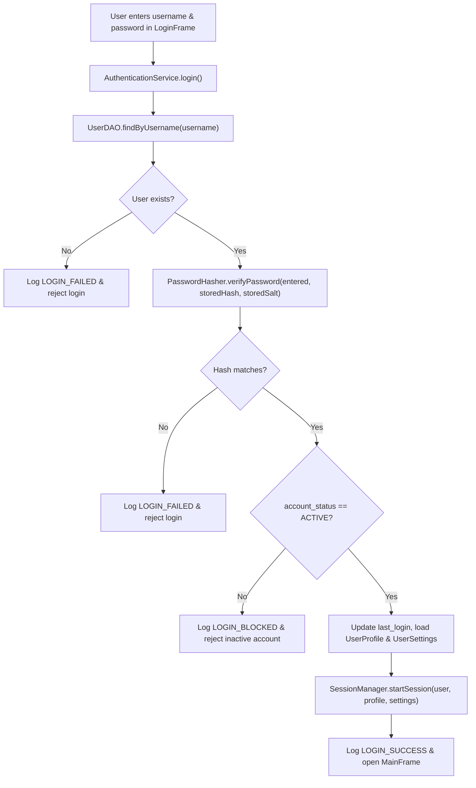

# Authentication System

Budgetly requires authentication before any user or administrator can access financial records or management tools.

---

## 1. Key Classes Responsible

| Class | Role |
| :--- | :--- |
| `LoginFrame` (`budgetlyDB.ui`) | Swing window collecting username and password; invokes `AuthenticationService.login(...)` on a `SwingWorker`. |
| `SignupFrame` (`budgetlyDB.ui`) | Swing window for new regular user registration; invokes `AuthenticationService.registerUser(...)`. |
| `AuthenticationService` (`budgetlyDB`) | Validates input, verifies passwords via `PasswordHasher`, runs transactional signup, updates `last_login`, loads profile & settings, and starts/clears `SessionManager`. |
| `PasswordHasher` (`budgetlyDB`) | Derives and verifies salted `PBKDF2WithHmacSHA256` hashes in constant time. |
| `SessionManager` (`budgetlyDB`) | Stores the active `User`, `UserProfile`, `UserSettings`, and enforces `requireLoggedIn()` and `requireAdmin()`. |
| `UserDAO` / `ActivityLogDAO` | Queries `USERS`, updates `last_login`, and records `LOGIN_SUCCESS`, `LOGIN_FAILED`, `LOGIN_BLOCKED`, `SIGNUP`, and `LOGOUT` audit entries. |

---

## 2. Administrator Authentication

- During `DatabaseInitializer.initialize()`, the database seeds one default administrator account (`admin` / `admin`) **only if** no `'admin'` username or `'ADMIN'` account already exists.
- The default password `"admin"` is hashed using `PasswordHasher.hashPassword(...)` with a random 16-byte salt — it is never stored in plain text.
- Administrators log in through the exact same `LoginFrame` and `AuthenticationService.login(...)` pipeline as regular users.
- Once authenticated, `SessionManager.isAdmin()` returns `true`, unlocking the **Admin Dashboard** button in `MainFrame` and permitting access to `AdminDashboard`, `UserManagementFrame`, and `DatabaseManagementFrame`.
- Administrators can change their password at any time in **Admin Dashboard -> Admin Settings** or **Profile & Settings**.

---

## 3. Regular User Registration Flow (`SignupFrame` -> `AuthenticationService.registerUser`)

1. User enters **First Name**, **Last Name**, **Username**, **Email**, **Password**, and **Confirm Password**.
2. `AuthenticationService.registerUser(...)` validates:
   - No required fields are blank.
   - Username matches `^[a-zA-Z0-9._-]{3,30}$`.
   - Email matches basic format validation (`^[^@\s]+@[^@\s]+\.[^@\s]+$`).
   - Password is at least 6 characters and matches Confirm Password.
3. Inside a single JDBC transaction (`con.setAutoCommit(false)`):
   - Checks `userDAO.existsByUsername(con, u)` -> rejects duplicates.
   - Checks `userDAO.existsByEmail(con, e)` -> rejects duplicates.
   - Generates a fresh salt and hashes the password via `PasswordHasher`.
   - Hardcodes `accountType = "USER"` and `accountStatus = "ACTIVE"` so regular users can **never** self-register as administrators.
   - Inserts rows into `USERS`, `USER_PROFILES`, `USER_SETTINGS`, creates a default `"Cash Wallet"` in `FINANCIAL_ACCOUNTS`, and logs `SIGNUP` in `USER_ACTIVITY_LOGS`.
   - Calls `con.commit()` (or `con.rollback()` if any step fails) and clears the `char[]` password arrays from memory.

---

## 4. Step-by-Step Login Verification Flow

---

## 5. Session Management, Role Checks & Logout

- **`SessionManager`** stores `currentUser`, `currentProfile`, `currentSettings`, and `loginTime`.
- **Role-Based Access Control**:
  - `MainFrame` only renders the **Admin Dashboard** button when `SessionManager.isAdmin()` is `true`.
  - Every admin frame constructor (`AdminDashboard`, `UserManagementFrame`, `DatabaseManagementFrame`) and every method in `AdminDAO` and `DatabaseManager` calls `SessionManager.requireAdmin()`, throwing `SecurityException` if a non-admin attempts access.
- **Logout**: Clicking **Logout** prompts for confirmation, calls `AuthenticationService.logout()` (which writes a `LOGOUT` entry to `USER_ACTIVITY_LOGS` and clears all fields in `SessionManager`), closes active workspace windows, and reopens `LoginFrame`.
