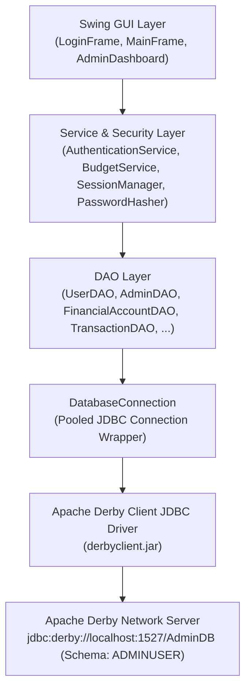

# Database Architecture

## 1. How Java Connects to Apache Derby (Java DB)

**Apache Derby** (also known as **Java DB** in NetBeans) is a lightweight relational database written in Java. In Budgetly, Derby runs as a **Network Server** listening on `localhost` port `1527`, storing its physical files inside the `AdminDB` directory.

**JDBC (Java Database Connectivity)** is Java's standard API (`java.sql.*`) that lets our Java code talk to Derby using SQL queries without hardcoding low-level network protocols. The Apache Derby client driver (`derbyclient.jar` + `derbyshared.jar`) translates JDBC calls (`Connection`, `PreparedStatement`, `ResultSet`) into network packets sent to `jdbc:derby://localhost:1527/AdminDB`.

---

## 2. Layered Architecture in `budgetlyDB`

Budgetly separates user interface code from database SQL logic using a clean 4-layer design:

1. **GUI Layer (`budgetly.ui` and `budgetlyDB.ui`)**: Swing `JFrame` and `JPanel` windows (`LoginFrame`, `MainFrame`, `AdminDashboard`, etc.) collect user input and render tables/cards. They run database calls on background threads via `SwingWorker`.
2. **Service Layer (`AuthenticationService`, `BudgetService`, `DatabaseManager`)**: Enforces business rules, input validation, session/authorization checks (`SessionManager`), and multi-table database **transactions** (`commit` / `rollback`).
3. **DAO Layer (`UserDAO`, `AdminDAO`, `ProfileDAO`, `SettingsDAO`, `ActivityLogDAO`, `FinancialAccountDAO`, `TransactionDAO`, `MonthlyBudgetDAO`)**: Contains all parameterized SQL statements (`PreparedStatement`) and maps `ResultSet` rows into Java model objects.
4. **Infrastructure & Model Layer (`DatabaseConnection`, `DatabaseInitializer`, `PasswordHasher`, `SessionManager`, `budgetlyDB.model.*`)**: Manages pooled Derby connections, schema startup, password security, session state, and domain objects.

---

## 3. How `budgetly.java` (`Budgetly.java`) Connects to `budgetlyDB`

The main application class `budgetly.Budgetly` no longer opens `MainFrame` directly as an unauthenticated prototype:

1. `Budgetly.main()` registers a shutdown hook calling `DatabaseConnection.shutdown()`.
2. It calls `DatabaseInitializer.initialize()` to verify all 7 tables and seed the default `admin` account if missing.
3. It opens `LoginFrame` on the Swing Event Dispatch Thread (EDT).
4. Only after `AuthenticationService.login(...)` succeeds and populates `SessionManager` does `LoginFrame` instantiate `MainFrame`.
5. Every panel inside `MainFrame` (`DashboardPanel`, `AccountsPanel`, `IncomePanel`, `ExpensesPanel`, `MonthlyBudgetPanel`, `TransactionHistoryPanel`, `ProfilePanel`) delegates data reads and writes to `BudgetService` and `AuthenticationService`.

---

## 4. How User Financial Records Are Isolated

Every user receives a unique auto-generated `user_id` primary key in `USERS`. All personal tables include `user_id` as a `FOREIGN KEY` referencing `USERS(user_id)`:

- `USER_PROFILES(user_id)`
- `USER_SETTINGS(user_id)`
- `FINANCIAL_ACCOUNTS(user_id)`
- `TRANSACTIONS(user_id)` and `TRANSACTIONS(account_id)`
- `MONTHLY_BUDGETS(user_id)`

**Defense-in-Depth Isolation:**

1. `BudgetService` never accepts an arbitrary `userId` parameter from a Swing button; instead, it always reads `SessionManager.getCurrentUserId()`.
2. Every `SELECT`, `UPDATE`, and `DELETE` SQL query in `FinancialAccountDAO`, `TransactionDAO`, and `MonthlyBudgetDAO` includes `WHERE user_id = ?` (and for `UPDATE`/`DELETE`, `WHERE <record_id> = ? AND user_id = ?`).
3. When recording a transaction in `BudgetService.recordTransaction(...)`, the service first executes `accountDAO.findByIdForUser(con, accountId, userId)` inside the transaction so a user can never post income or expenses to another user's account ID.
