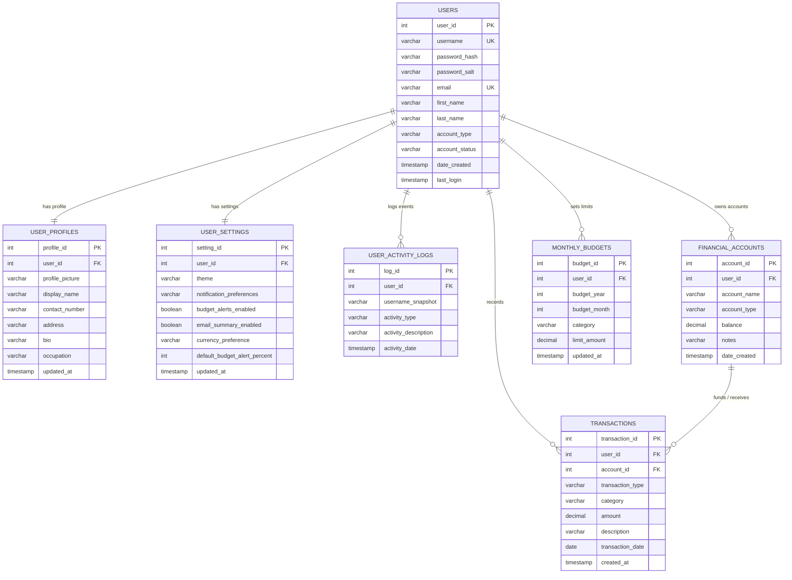

# Database Tables & Schema Reference

All Budgetly database tables live in Apache Derby database **`AdminDB`** under schema **`ADMINUSER`**.

---

## 1. Entity Relationship Diagram (ERD)

---

## 2. Table Specifications

### `USERS`
Stores authentication credentials, user identity, role, and account status.

| Column | Derby Data Type | Constraints | Description |
| :--- | :--- | :--- | :--- |
| `user_id` | `INT` | `PRIMARY KEY`, `GENERATED ALWAYS AS IDENTITY` | Unique user identifier |
| `username` | `VARCHAR(50)` | `NOT NULL`, `UNIQUE` | Login username |
| `password_hash` | `VARCHAR(256)` | `NOT NULL` | `PBKDF2WithHmacSHA256` hash (`iterations:Base64`) |
| `password_salt` | `VARCHAR(128)` | `NOT NULL` | Base64-encoded 16-byte random salt |
| `email` | `VARCHAR(120)` | `NOT NULL`, `UNIQUE` | Unique user email address |
| `first_name` | `VARCHAR(60)` | `NOT NULL` | First name |
| `last_name` | `VARCHAR(60)` | `NOT NULL` | Last name |
| `account_type` | `VARCHAR(20)` | `NOT NULL`, `CHECK IN ('ADMIN', 'USER')` | Role authorization level |
| `account_status` | `VARCHAR(20)` | `NOT NULL`, `CHECK IN ('ACTIVE', 'INACTIVE')` | Account enabled/disabled flag |
| `date_created` | `TIMESTAMP` | `NOT NULL`, `DEFAULT CURRENT_TIMESTAMP` | Registration timestamp |
| `last_login` | `TIMESTAMP` | Nullable | Most recent successful sign-in |

### `USER_PROFILES`
Stores personal profile details in a 1-to-1 relationship with `USERS`.

| Column | Derby Data Type | Constraints | Description |
| :--- | :--- | :--- | :--- |
| `profile_id` | `INT` | `PRIMARY KEY`, `GENERATED ALWAYS AS IDENTITY` | Profile record ID |
| `user_id` | `INT` | `NOT NULL`, `UNIQUE`, `FK -> USERS(user_id) ON DELETE CASCADE` | Owning user |
| `profile_picture` | `VARCHAR(255)` | Default `'default_croc'` | Avatar identifier |
| `display_name` | `VARCHAR(100)` | `NOT NULL` | Friendly display name in sidebar/dashboard |
| `contact_number` | `VARCHAR(30)` | Default `''` | Phone number |
| `address` | `VARCHAR(255)` | Default `''` | Home or mailing address |
| `bio` | `VARCHAR(500)` | Default `''` | Personal notes/bio |
| `occupation` | `VARCHAR(100)` | Default `''` | Job or student role |
| `updated_at` | `TIMESTAMP` | `NOT NULL`, `DEFAULT CURRENT_TIMESTAMP` | Last modification timestamp |

### `USER_SETTINGS`
Stores per-user application preferences in a 1-to-1 relationship with `USERS`.

| Column | Derby Data Type | Constraints | Description |
| :--- | :--- | :--- | :--- |
| `setting_id` | `INT` | `PRIMARY KEY`, `GENERATED ALWAYS AS IDENTITY` | Settings record ID |
| `user_id` | `INT` | `NOT NULL`, `UNIQUE`, `FK -> USERS(user_id) ON DELETE CASCADE` | Owning user |
| `theme` | `VARCHAR(30)` | `NOT NULL`, Default `'LIGHT'` | UI theme (`LIGHT`, `FOREST`, `DARK`) |
| `notification_preferences` | `VARCHAR(100)` | `NOT NULL`, Default `'BUDGET_AND_SECURITY'` | Alert notification mode |
| `budget_alerts_enabled` | `BOOLEAN` | `NOT NULL`, Default `TRUE` | Enable/mute budget alert banners |
| `email_summary_enabled` | `BOOLEAN` | `NOT NULL`, Default `FALSE` | Monthly summary opt-in |
| `currency_preference` | `VARCHAR(10)` | `NOT NULL`, Default `'PHP'` | Currency (`PHP`, `USD`, `EUR`, `GBP`, `JPY`) |
| `default_budget_alert_percent` | `INT` | `NOT NULL`, Default `80` | Warning threshold percentage |
| `updated_at` | `TIMESTAMP` | `NOT NULL`, `DEFAULT CURRENT_TIMESTAMP` | Last modification timestamp |

### `USER_ACTIVITY_LOGS`
Stores authentication, administrative, and financial audit events.

| Column | Derby Data Type | Constraints | Description |
| :--- | :--- | :--- | :--- |
| `log_id` | `INT` | `PRIMARY KEY`, `GENERATED ALWAYS AS IDENTITY` | Audit log ID |
| `user_id` | `INT` | Nullable `FK -> USERS(user_id) ON DELETE SET NULL` | Associated user (null for unknown login attempts or deleted users) |
| `username_snapshot` | `VARCHAR(50)` | Nullable | Username string captured at event time |
| `activity_type` | `VARCHAR(40)` | `NOT NULL` | Event category (`LOGIN_SUCCESS`, `SIGNUP`, `ADMIN_ACTION`, etc.) |
| `activity_description` | `VARCHAR(500)` | `NOT NULL` | Human-readable event description |
| `activity_date` | `TIMESTAMP` | `NOT NULL`, `DEFAULT CURRENT_TIMESTAMP` | Event timestamp |

### `FINANCIAL_ACCOUNTS`
Stores each user's Cash, Bank, E-Wallet, and Other accounts.

| Column | Derby Data Type | Constraints | Description |
| :--- | :--- | :--- | :--- |
| `account_id` | `INT` | `PRIMARY KEY`, `GENERATED ALWAYS AS IDENTITY` | Financial account ID |
| `user_id` | `INT` | `NOT NULL`, `FK -> USERS(user_id) ON DELETE CASCADE` | Owning user |
| `account_name` | `VARCHAR(80)` | `NOT NULL`, `UNIQUE(user_id, account_name)` | Account name (e.g., `Cash Wallet`) |
| `account_type` | `VARCHAR(30)` | `NOT NULL`, `CHECK IN ('CASH', 'BANK', 'EWALLET', 'OTHER')` | Account category |
| `balance` | `DECIMAL(15, 2)` | `NOT NULL`, Default `0.00` | Current account balance |
| `notes` | `VARCHAR(255)` | Default `''` | Optional notes |
| `date_created` | `TIMESTAMP` | `NOT NULL`, `DEFAULT CURRENT_TIMESTAMP` | Creation timestamp |

### `TRANSACTIONS`
Stores income and expense entries linked to both a user and one of their `FINANCIAL_ACCOUNTS`.

| Column | Derby Data Type | Constraints | Description |
| :--- | :--- | :--- | :--- |
| `transaction_id` | `INT` | `PRIMARY KEY`, `GENERATED ALWAYS AS IDENTITY` | Transaction ID |
| `user_id` | `INT` | `NOT NULL`, `FK -> USERS(user_id) ON DELETE CASCADE` | Owning user |
| `account_id` | `INT` | `NOT NULL`, `FK -> FINANCIAL_ACCOUNTS(account_id) ON DELETE CASCADE` | Account credited or debited |
| `transaction_type` | `VARCHAR(15)` | `NOT NULL`, `CHECK IN ('INCOME', 'EXPENSE')` | Income or Expense |
| `category` | `VARCHAR(60)` | `NOT NULL` | Category (`Salary`, `Food`, `Bills`, etc.) |
| `amount` | `DECIMAL(15, 2)` | `NOT NULL`, `CHECK (amount > 0)` | Positive transaction amount |
| `description` | `VARCHAR(255)` | Default `''` | User memo |
| `transaction_date` | `DATE` | `NOT NULL` | Transaction calendar date |
| `created_at` | `TIMESTAMP` | `NOT NULL`, `DEFAULT CURRENT_TIMESTAMP` | Record creation timestamp |

### `MONTHLY_BUDGETS`
Stores monthly spending limits overall or per expense category for each user.

| Column | Derby Data Type | Constraints | Description |
| :--- | :--- | :--- | :--- |
| `budget_id` | `INT` | `PRIMARY KEY`, `GENERATED ALWAYS AS IDENTITY` | Budget record ID |
| `user_id` | `INT` | `NOT NULL`, `FK -> USERS(user_id) ON DELETE CASCADE` | Owning user |
| `budget_year` | `INT` | `NOT NULL` | Target calendar year |
| `budget_month` | `INT` | `NOT NULL`, `CHECK (budget_month BETWEEN 1 AND 12)` | Target month (1–12) |
| `category` | `VARCHAR(60)` | `NOT NULL`, Default `'OVERALL'`, `UNIQUE(user_id, budget_year, budget_month, category)` | `'OVERALL'` or expense category |
| `limit_amount` | `DECIMAL(15, 2)` | `NOT NULL`, `CHECK (limit_amount > 0)` | Maximum spending limit |
| `updated_at` | `TIMESTAMP` | `NOT NULL`, `DEFAULT CURRENT_TIMESTAMP` | Last modification timestamp |
