# BUDGETLY – UML CLASS DIAGRAM

This document presents the complete UML Class Diagram for **BUDGETLY – Personal Budget Tracker**. The entire application is built with **20 declared Java types** (15 concrete classes, 2 abstract classes, 1 interface, and 2 enums) across 6 packages.

---

## 1. Summary of All 20 Java Types

| # | Package | Type Name | Kind | Responsibility |
|---|---------|-----------|------|----------------|
| 1 | `budgetly` | `Main` | Class | Application entry point; initializes database, seeds initial admin, and opens `LoginFrame` on the EDT |
| 2 | `budgetly.database` | `DatabaseConnection` | Class | Centralizes Apache Derby Client JDBC configuration, starts local Derby server if needed, and runs `schema.sql` |
| 3 | `budgetly.model` | `Manageable` | Interface | Contract (`matches`, `getSummary`) shared by searchable and manageable entities (`User`, `Transaction`) |
| 4 | `budgetly.model` | `UserRole` | Enum | Account roles (`ADMIN`, `USER`) with display labels |
| 5 | `budgetly.model` | `TransactionType` | Enum | Transaction types (`INCOME`, `EXPENSE`) and their default category lists |
| 6 | `budgetly.model` | `User` | Abstract Class | Encapsulates common user account fields and declares abstract role/permission methods |
| 7 | `budgetly.model` | `Admin` | Class | Subclass of `User` representing an administrator (`canManageUsers() = true`) |
| 8 | `budgetly.model` | `RegularUser` | Class | Subclass of `User` representing a regular user (`canManageUsers() = false`) |
| 9 | `budgetly.model` | `Transaction` | Abstract Class | Base class for financial transactions; declares `getType()` and `getSignedAmount()` |
| 10 | `budgetly.model` | `Income` | Class | Subclass of `Transaction` that returns positive signed amounts (`+amount`) |
| 11 | `budgetly.model` | `Expense` | Class | Subclass of `Transaction` that returns negative signed amounts (`-amount`) |
| 12 | `budgetly.model` | `Budget` | Class | Encapsulates a user's monthly spending limit and calculates remaining budget and usage percentage |
| 13 | `budgetly.dao` | `UserDAO` | Class | JDBC CRUD operations, password hash lookup, atomic user deletion, and system statistics for `USERS` |
| 14 | `budgetly.dao` | `TransactionDAO` | Class | JDBC CRUD operations and monthly expense totals for `TRANSACTIONS` scoped by `user_id` |
| 15 | `budgetly.dao` | `BudgetDAO` | Class | JDBC lookup, insert, and update operations for `BUDGETS` |
| 16 | `budgetly.service` | `AuthService` | Class | Registration, login, PBKDF2 password hashing with random salt, profile updates, and admin user management |
| 17 | `budgetly.service` | `BudgetService` | Class | Transaction/budget validation, `BigDecimal` calculations, and generic `search` and `sort` methods |
| 18 | `budgetly.gui` | `LoginFrame` | Class | Swing Login and Registration window using `CardLayout` and the official BUDGETLY logo |
| 19 | `budgetly.gui` | `MainFrame` | Class | Swing Regular User Dashboard with sidebar `CardLayout` (Dashboard, Income, Expenses, Budget, History, Settings & Docs) |
| 20 | `budgetly.gui` | `AdminDashboard` | Class | Swing Administrator Dashboard for viewing statistics, searching/managing users, and accessing admin settings & docs |

---

## 2. Mermaid UML Class Diagram

```mermaid
classDiagram
    direction TB

    class Manageable {
        <<interface>>
        +matches(String keyword) boolean
        +getSummary() String
    }

    class UserRole {
        <<enumeration>>
        ADMIN
        USER
        +getLabel() String
    }

    class TransactionType {
        <<enumeration>>
        INCOME
        EXPENSE
        +getLabel() String
        +getCategories() String[]
    }

    class User {
        <<abstract>>
        -int userId
        -String fullName
        -String username
        -String email
        -Boolean active
        -LocalDateTime createdAt
        +getRole()* UserRole
        +canManageUsers()* boolean
        +getDashboardTitle()* String
        +getStatusText() String
        +matches(String keyword) boolean
        +getSummary() String
    }

    class Admin {
        +getRole() UserRole
        +canManageUsers() boolean
        +getDashboardTitle() String
    }

    class RegularUser {
        +getRole() UserRole
        +canManageUsers() boolean
        +getDashboardTitle() String
    }

    class Transaction {
        <<abstract>>
        -Integer transactionId
        -int userId
        -String description
        -BigDecimal amount
        -String category
        -LocalDate date
        +create(TransactionType, Integer, int, String, BigDecimal, String, LocalDate)$ Transaction
        +getType()* TransactionType
        +getSignedAmount()* BigDecimal
        +matches(String keyword) boolean
        +getSummary() String
    }

    class Income {
        +getType() TransactionType
        +getSignedAmount() BigDecimal
    }

    class Expense {
        +getType() TransactionType
        +getSignedAmount() BigDecimal
    }

    class Budget {
        -Integer budgetId
        -int userId
        -BigDecimal monthlyLimit
        -int month
        -int year
        +getRemaining(BigDecimal spent) BigDecimal
        +isReached(BigDecimal spent) boolean
        +getUsagePercentage(BigDecimal spent) Double
    }

    class DatabaseConnection {
        +URL$ String
        +getConnection()$ Connection
        +initializeDatabase()$ void
    }

    class UserDAO {
        +insertUser(String, String, String, UserRole) void
        +usernameExists(String, int) boolean
        +findByUsername(String) User
        +getPasswordHash(int) String
        +findAll() List~User~
        +updateProfile(int, String, String, String) void
        +updatePassword(int, String) void
        +setActive(int, boolean) boolean
        +deleteUser(int) boolean
        +adminExists() boolean
        +getStatistics() Map~String, Long~
    }

    class TransactionDAO {
        +insert(Transaction) void
        +update(Transaction) boolean
        +delete(int, int) boolean
        +findByUser(int) List~Transaction~
        +getMonthlyExpenses(int, int, int) BigDecimal
    }

    class BudgetDAO {
        +findBudget(int, int, int) Budget
        +insert(Budget) void
        +update(Budget) void
    }

    class AuthService {
        -UserDAO userDAO
        +initializeDefaultAdmin() void
        +register(String, String, String, String) String
        +login(String, String) User
        +updateProfile(User, String, String, String) String
        +changePassword(User, String, String, String) String
        +getAllUsers(User) List~User~
        +getStatistics(User) Map~String, Long~
        +setUserActive(User, int, boolean) boolean
        +deleteUser(User, int) boolean
    }

    class BudgetService {
        -TransactionDAO transactionDAO
        -BudgetDAO budgetDAO
        +saveTransaction(Integer, int, TransactionType, String, String, String, String) String
        +deleteTransaction(int, int) boolean
        +getUserTransactions(int) List~Transaction~
        +filterByType(List~Transaction~, TransactionType) List~Transaction~
        +search(List~T~, String)$ List~T~
        +sort(List~T~, Comparator~T~)$ List~T~
        +calculateTotal(List~Transaction~, TransactionType) BigDecimal
        +calculateBalance(List~Transaction~) BigDecimal
        +getBudget(int, int, int) Budget
        +saveBudget(int, String, int, int) String
    }

    class Main {
        +main(String[] args)$ void
    }

    class LoginFrame {
        -AuthService authService
        +loadLogoIcon(int, int)$ ImageIcon
        +applyWindowIcon(JFrame)$ void
    }

    class MainFrame {
        -User currentUser
        -AuthService authService
        -BudgetService budgetService
        +refreshAllData() void
        +createSettingsAndDocsPanel(User, AuthService, Runnable)$ JPanel
    }

    class AdminDashboard {
        -User adminUser
        -AuthService authService
        +refreshUsersAndStats() void
    }

    Manageable <|.. User
    Manageable <|.. Transaction
    User <|-- Admin
    User <|-- RegularUser
    Transaction <|-- Income
    Transaction <|-- Expense
    User --> UserRole
    Transaction --> TransactionType

    UserDAO ..> DatabaseConnection
    TransactionDAO ..> DatabaseConnection
    BudgetDAO ..> DatabaseConnection
    UserDAO ..> User
    TransactionDAO ..> Transaction
    BudgetDAO ..> Budget

    AuthService *-- UserDAO
    BudgetService *-- TransactionDAO
    BudgetService *-- BudgetDAO
    BudgetService ..> Manageable

    Main ..> DatabaseConnection
    Main ..> AuthService
    Main ..> LoginFrame
    LoginFrame --> AuthService
    LoginFrame ..> MainFrame
    LoginFrame ..> AdminDashboard
    MainFrame --> User
    MainFrame --> AuthService
    MainFrame --> BudgetService
    AdminDashboard --> User
    AdminDashboard --> AuthService
```

