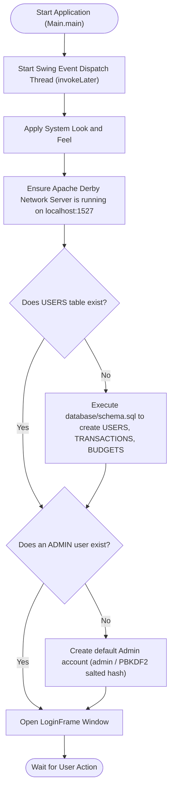
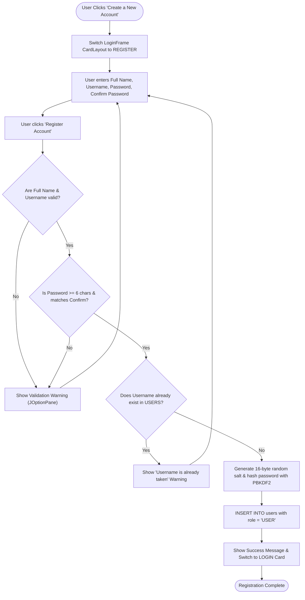
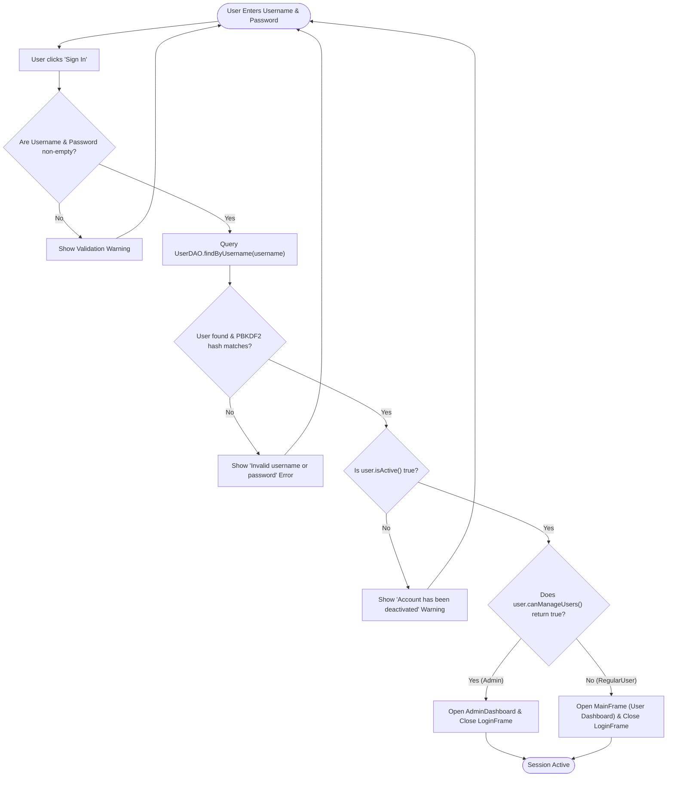
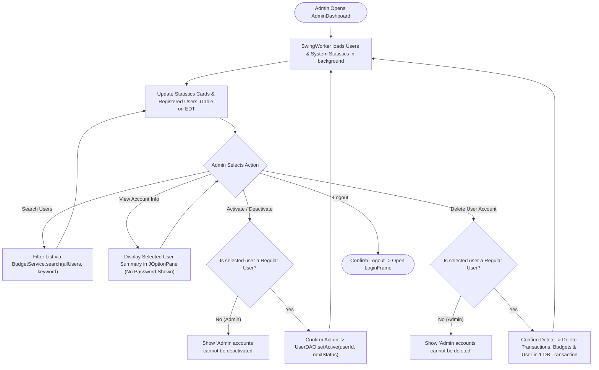
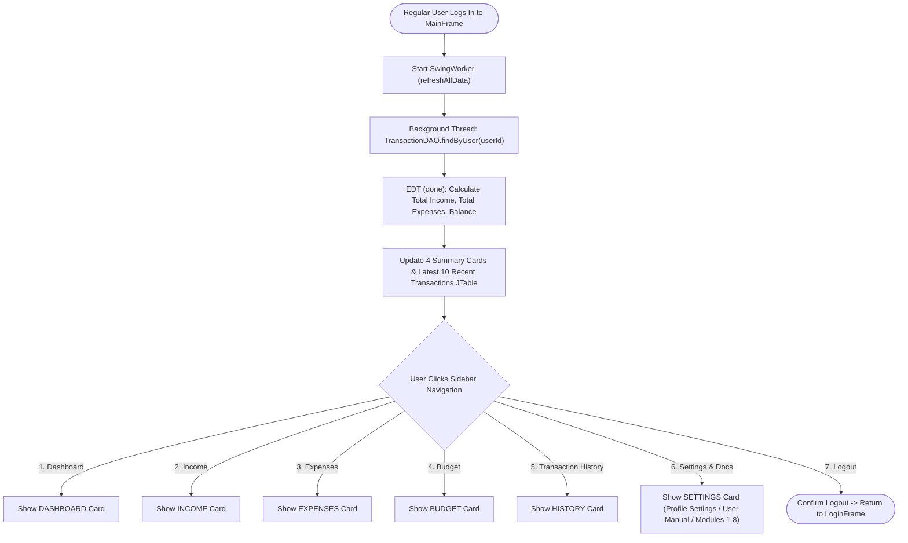
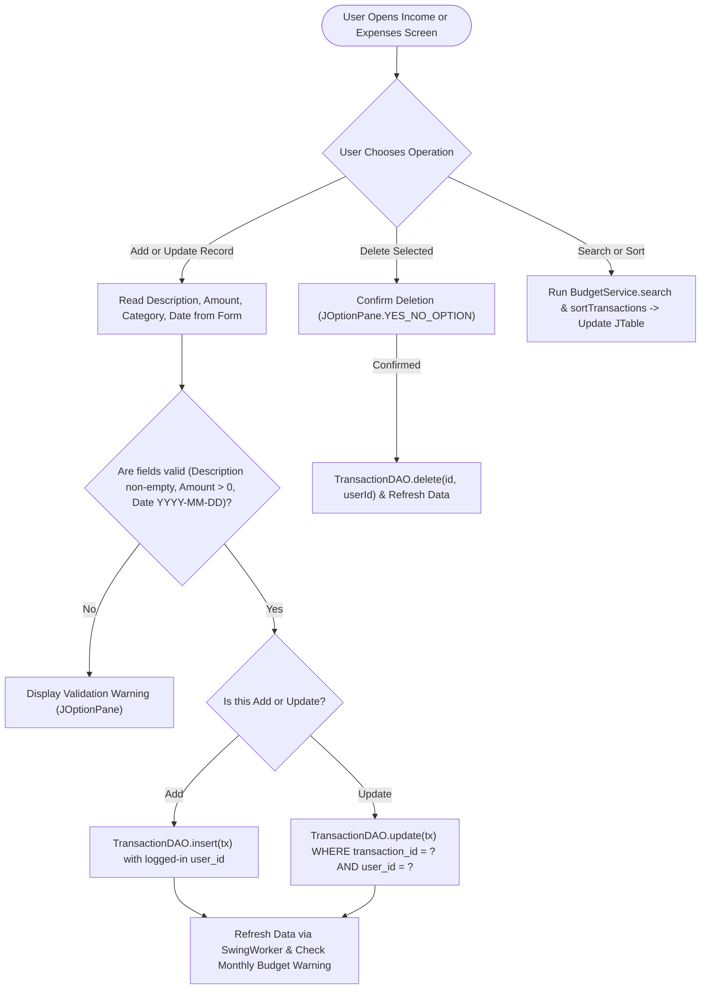
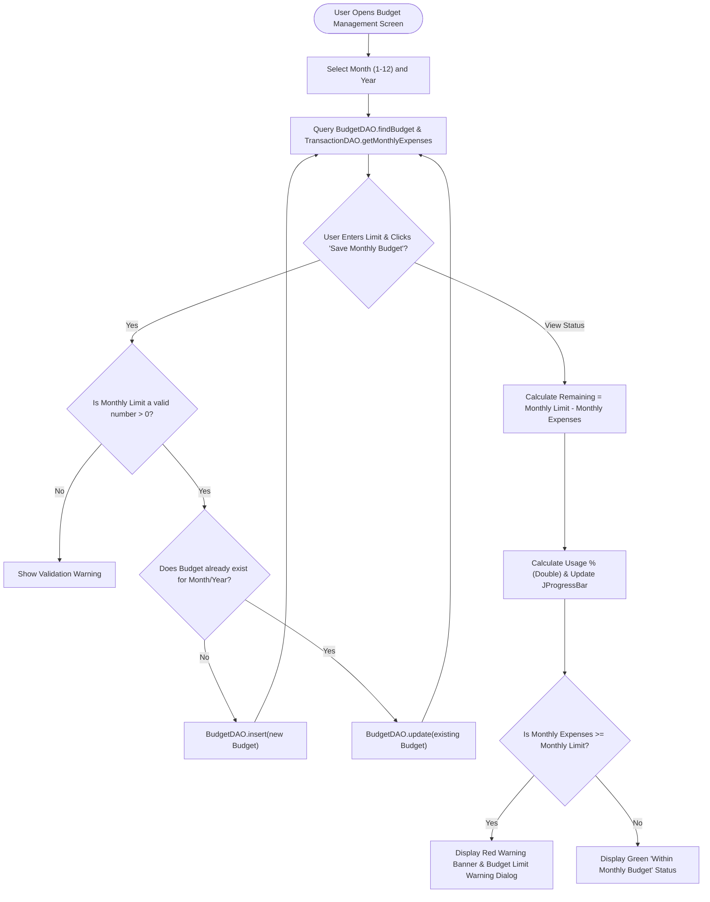

# BUDGETLY – SYSTEM FLOWCHARTS

This document contains the seven classroom-ready Mermaid flowcharts for **BUDGETLY – Personal Budget Tracker**.

---

## 1. Application Startup Flowchart

---

## 2. User Registration Flowchart

---

## 3. User Login Flowchart

---

## 4. Admin Dashboard and User Management Flowchart

---

## 5. User Dashboard Flowchart

---

## 6. Income and Expense Management Flowchart

---

## 7. Budget Management Flowchart

